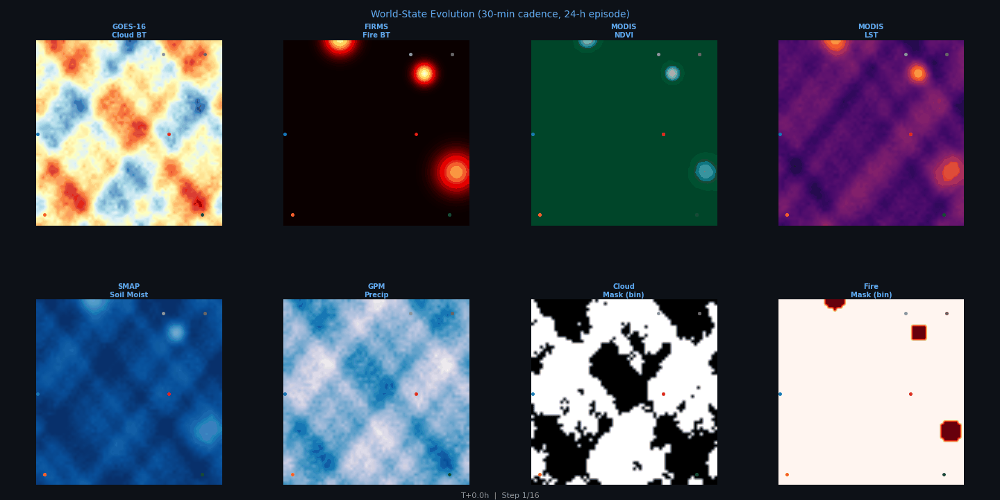

# SIRLO: Digital Twin Satellite Constellation Framework

## Overview
SIRLO is an advanced simulation framework for developing autonomous decision-making strategies for satellite constellations. It leverages Multi-Agent Reinforcement Learning (MARL) to optimize high-cadence environmental monitoring missions, such as wildfire detection in the Amazon.

Traditional satellite tasking relies on pre-computed schedules from ground stations, which often fail to adapt to dynamic conditions like fast-moving clouds or transient thermal events. SIRLO empowers satellites with onboard intelligence, enabling them to make real-time decisions based on local observations and cooperative strategies.



## Key Features

### 1. Dynamic World State Generation
The environment is powered by **Google Earth Engine (GEE)**, providing a high-fidelity representation o global conditions.
- **Cloud Cover**: Integrates real-time cloud data from **GOES-16** (Geostationary Operational Environmental Satellite) to predict optical occlusions.
- **Thermal Anomalies**: Utilizes **FIRMS** (Fire Information for Resource Management System) data to identify high-value monitoring targets.
- **Tensor Representation**: The world state is synthesized into a multi-channel tensor (Cloud, Fire) suitable for deep learning models.

### 2. High-Fidelity Orbital Propagation
Satellite orbits are simulated using the **Skyfield** library, which implements SGP4 propagation with high precision.
- **Visibility Analysis**: Calculates satellite ground tracks and sensor footprints to determine target visibility windows.
- **Constellation Management**: Supports scalable constellations with diverse orbital parameters.

### 3. Intelligent Agents (Vision Transformer)
Each satellite is controlled by a **Vision Transformer (ViT)** agent. Behaving as an autonomous entity, the agent processes spatiotemporal environment data to make optimal decisions.
- **Input**: Local "World State" tensor (visual context) + Internal Satellite State (Battery, Storage).
- **Architecture**:
    - **Patch Embedding**: Divides the visual input into patches processed by the transformer.
    - **Self-Attention**: Captures global dependencies and spatial relationships in the environment.
    - **State Fusion**: Integrates internal system metrics (energy, data buffer).
- **Output**: Action probability distribution (Task Prioritization).

### 4. Multi-Agent Reinforcement Learning (MARL)
The framework uses a cooperative MARL approach to train the constellation.
- **Objective**: Maximize the global throughput of high-value data (e.g., clear images of fires) while minimizing resource consumption.
- **Reward Signal**:
    - **+** Successful imaging of a high-priority target.
    - **+** Successful data downlink to ground stations.
    - **-** Imaging cloud-obscured areas (wasted resources).
    - **-** Battery depletion or buffer overflow.
- **Algorithm**: Supports Policy Gradient methods (e.g., REINFORCE, PPO) with shared policies for efficient scaling.

## Project Structure
```
SIRLO/
├── src/
│   ├── env/            # Environment Simulation Modules
│   │   ├── world_state.py  # GEE Data Integration
│   │   ├── propagator.py   # Orbital Mechanics (Skyfield)
│   │   └── satellite.py    # Satellite Subsystem Model
│   ├── agents/         # AI Models
│   │   └── vit_agent.py    # Vision Transformer Implementation
│   ├── training/       # RL Training Loop
│   │   ├── marl_env.py     # Gym-like Environment Wrapper
│   │   └── trainer.py      # Training Algorithm (REINFORCE)
│   └── utils/          # Helper Utilities
│       └── gee_auth.py     # GEE Authentication
├── config/             # Configuration Files
├── tests/              # Unit Tests
├── main.py             # Entry Point
└── requirements.txt    # Python Dependencies
```

## Installation & Usage

1.  **Install Dependencies**:
    ```bash
    pip install -r requirements.txt
    ```

2.  **Authenticate Google Earth Engine**:
    This project requires a GEE account. Authenticate your local environment:
    ```bash
    earthengine authenticate
    ```

3.  **Run Training**:
    Start the MARL training loop to train the satellite agents:
    ```bash
    python main.py
    ```
    (Note: `main.py` currently checks the environment; run `python src/training/trainer.py` for training).

## Optimization
The framework is designed to leverage hardware acceleration (e.g., NVIDIA RTX 5090) for tensor operations, enabling large-scale simulations with hundreds of agents and complex environmental models.
